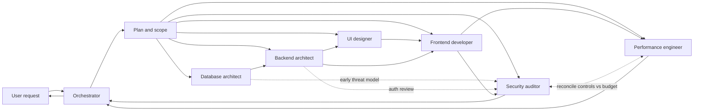

# agent-playbook

Portable **agent workflow playbook** for AI-orchestrated development.

Tool-agnostic orchestration specs (roles, phases, handoffs) that you can clone into any project and keep out of the host repository via `.gitignore`. Independent of IDE, OS, cloud provider, and git host.

## Overview

High-level Agent Workflow Orchestration. Specialists do not share memory; the orchestrator plans, delegates self-contained tasks, tracks artifacts, and integrates results. Not every request needs every phase.

Typical phases (scoped down per request):

1. **Foundation** — data layer
2. **Services** — APIs, auth, service boundaries
3. **Design** — UI states and interaction specs
4. **Implementation** — client against contract + design
5. **Hardening** — security audit and performance pass

## Project documentation vs playbook core

| Path | Role | When this playbook is coupled into a host project |
| ---- | ---- | ------------------------------------------------ |
| Playbook core (orchestrator, agent specs, shared conventions for *host* work) | Consumed by orchestration | **Use** |
| [`docs/`](docs/) | Meta docs for **evolving this repository** (commits, branches, setup) | **Ignore** — host project conventions win |

Orchestrators and agents must not apply `docs/` rules to a host repository. Those files exist only to govern how *agent-playbook* itself is developed and reviewed.

## Documentation

Project-evolution docs (this repository only — see table above):

1. [Commit patterns](docs/commit-patterns.md)
2. [Branch management](docs/branch-management.md)
3. [Setup](docs/setup.md) — pending in follow-up PR

## Status

Initial scaffold. Core orchestration and agent specs come next; project conventions land via documentation PRs.

## License

Private repository. All rights reserved.
