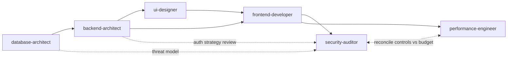

# Agent Registry

Fixed roster for this playbook. Do not add or remove agents without updating this file. Each row maps a role to its spec file and a stable frontmatter `name` (for hosts that use named agent configs).

| # | Role | File | Frontmatter `name` | One-line job |
| - | ---- | ---- | ------------------ | ------------ |
| 1 | database-architect | [database-architect-agent.md](database-architect-agent.md) | `database-design-database-architect` | Chooses data stores and designs schema, indexing, and scaling strategy |
| 2 | backend-architect | [backend-architect-agent.md](backend-architect-agent.md) | `backend-development-backend-architect` | Designs service boundaries, API contracts, auth strategy, and inter-service communication |
| 3 | ui-designer | [ui-designer-agent.md](ui-designer-agent.md) | `product-design-ui-designer` | Designs visual system, component states, and interaction/motion specs |
| 4 | frontend-developer | [frontend-developer-agent.md](frontend-developer-agent.md) | `multi-platform-apps-frontend-developer` | Implements client UI on the host stack against the API contract and design specs |
| 5 | security-auditor | [security-auditor-agent.md](security-auditor-agent.md) | `security-scanning-security-auditor` | Threat models early, audits auth/data/client security, runs a final pre-release pass |
| 6 | performance-engineer | [performance-engineer-agent.md](performance-engineer-agent.md) | `application-performance-performance-engineer` | Measures and optimizes the built system; reconciles perf budgets with security controls |

## Dependency graph

- **Solid arrows** = hard sequencing (target needs an artifact from the source).
- **Dotted arrows** = security-auditor early, parallel involvement (does not block Foundation/Services).
- **security-auditor** runs early (design review) and late (final audit). **performance-engineer** runs late, once there is a real system to measure.

## Phases

1. **Foundation** — database-architect designs the data layer. security-auditor may start threat modeling in parallel.
2. **Services** — backend-architect designs APIs/services on the data layer; settles auth with security-auditor.
3. **Design** — ui-designer specs UI against real backend contract states (loading, error, empty, real-time).
4. **Implementation** — frontend-developer builds against the backend contract and design spec.
5. **Hardening** — security-auditor final audit; performance-engineer measures and optimizes; conflicts with security controls are reconciled, not silently traded away.

Not every request needs all five phases — see [ORCHESTRATOR.md](../ORCHESTRATOR.md).

## Adding or changing an agent

This roster is intentionally closed. If a new agent is introduced, update this table, the dependency graph, and the Workflow Position / Key Distinctions sections of every agent it touches. A dangling reference is a bug: the orchestrator would delegate to something that does not exist.
